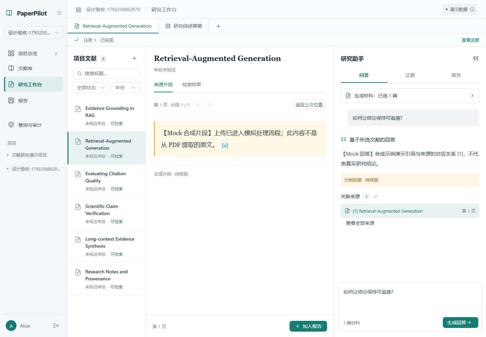
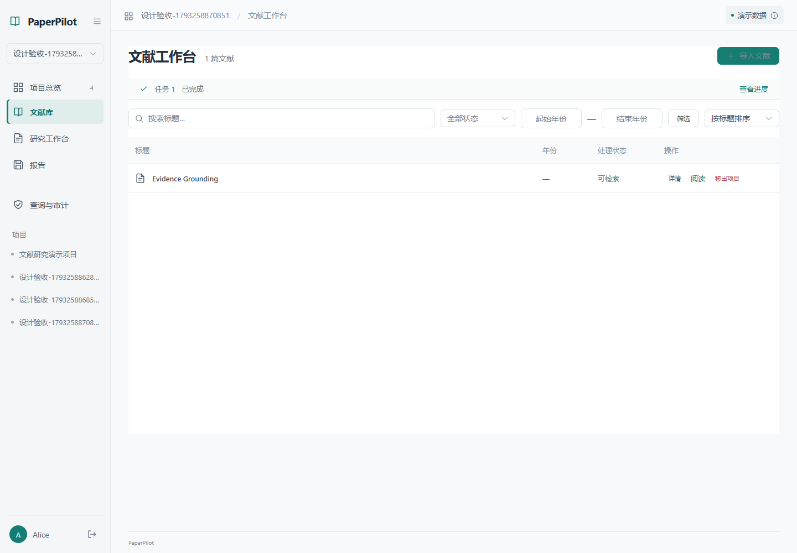

# PaperPilot Secure

面向科研人员的 AI 文献研究工作台，连接文献管理、来源阅读、AI 问答、证据提取与报告版本。前端采用紧凑文献列表、来源阅读和研究助手三栏布局；后端通过数据层、AI 与安全适配器接入，保留 AB-1 数据契约、任务恢复和引用快照。

## 工作台



实际运行截图，使用隔离 Mock 测试的合成文献与回答。

- **文献管理**：按标题、状态和年份查找文献，按标题或年份排序；点击“导入文献”打开上传抽屉。
- **来源阅读**：切换文献与片段，点击回答引用直接定位来源，并可返回上次位置。
- **AI 问答**：明确选择生成材料，最多 50 篇可检索文献；阅读文献的选择与生成范围相互独立。
- **证据与报告**：查看已有证据或主动提取，将来源加入报告，保存版本与引用快照；切换报告或历史版本前保护未保存编辑。
- **任务反馈**：主界面只显示简短状态，点击“查看进度”展开查询、错误及原请求核对操作。窄屏使用“阅读 / 问答 / 证据 / 报告”切换工作区。

当前阅读区展示**来源片段与页码**，尚未提供完整 PDF 阅读器或 PDF 页内坐标高亮。片段检索使用项目、年份和检索模式；回答与草稿生成使用明确选定的文献集合，两者的范围分别设置。

<details>
<summary>查看文献库界面</summary>



</details>

设计依据、竞品源码与后续规划见 [工作台交互研究报告](docs/paperpilot-workspace-ux-research-2026-10-29.md)。该报告保留研究阶段记录，后续规划不代表已经实现。成员协作从 [统一开发指南](docs/development-guide.md) 开始，其他模块的实际验收与限制见 [验证记录](docs/verification.md)。

## 当前运行边界

**开发模式可显式选择 Mock，统一组合入口可注册 PostgreSQL、真实 AI 与 D 策略适配器。已实现基于 PostgreSQL 的凭据认证；正式认证、数据库安全权限及生产部署尚未完成验收，生产模式拒绝启动。真实 SQL 执行默认关闭，候选执行器只允许明确的隔离测试配置。历史 SQLite 实验保留。**

## 技术栈

- 前端：Vue 3、TypeScript、Vite、Vue Router、Element Plus、openapi-fetch。
- 后端：Python 3.12、FastAPI、Pydantic，按 routes/services/adapters 分层。
- 契约：后端 Schema → OpenAPI 3.1 JSON → 自动生成 TypeScript 类型。
- 验证：pytest、JSON Schema、Ruff、vue-tsc、Vite build、Playwright。
- 数据：DataPort 和独立生命周期注册；当前真实持久化实现为 PostgreSQL，需显式迁移和配置。

## 本地启动

需要 Python 3.12、Node.js 24（本次验证 24.14.1）及 npm。以下命令在仓库根目录的 PowerShell 执行。

```powershell
python -m venv .venv
.\.venv\Scripts\python.exe -m pip install -r requirements.lock
.\.venv\Scripts\python.exe -m pip install --no-deps -e .
npm.cmd --prefix frontend ci
```

终端一（明确启用本机开发身份；不要用于生产）：

```powershell
$env:PAPERPILOT_ENV = 'development'
$env:PAPERPILOT_AUTH_MODE = 'development'
.\.venv\Scripts\python.exe -m uvicorn app.main:create_app --factory --app-dir backend --host 127.0.0.1 --port 8000 --no-access-log
```

终端二：

```powershell
npm.cmd --prefix frontend run dev
```

打开 [本地工作台](http://127.0.0.1:5173/)，交互 API 文档位于 [FastAPI Docs](http://127.0.0.1:8000/docs)。
也可使用 `scripts/start-backend.ps1` 和 `scripts/start-frontend.ps1`。

Linux/macOS 将 `.venv\Scripts\python.exe` 换成 `.venv/bin/python`，将 `npm.cmd` 换成 `npm`；当前验证平台为 Windows。

开发身份为 `alice`、`bob`、`eve`，**不需要密码，也不验证真实身份**。Mock 中 Alice 是预置项目负责人、Bob 是其成员、Eve 属于另一个项目。任何能访问开发服务的人都可以切换身份，因此仅供本机开发。

## 环境变量和适配器

变量清单见 `.env.example`。默认三个适配器均为 `mock`，只监听本机。程序读取进程环境变量，**不会自动加载 `.env` 文件**；复制示例文件不会自动改变配置。

```powershell
$env:PAPERPILOT_ENV = 'development'
$env:PAPERPILOT_AUTH_MODE = 'development'
$env:PAPERPILOT_A_MODE = 'mock'
$env:PAPERPILOT_C_MODE = 'mock'
$env:PAPERPILOT_D_MODE = 'mock'
```

- 使用 `app.dev_composition:create_app` 统一入口时，A/C/D 根据显式模式注册；连接、初始化或健康检查失败即拒绝启动，无自动回退。直接使用 `app.main:create_app` 时真实适配器需显式注入。
- PostgreSQL 需显式提供连接配置、执行迁移并初始化账户；应用不会自动迁移、创建演示账号或启动 outbox 投递器。
- `PAPERPILOT_AUTH_MODE=development` 仅供开发，`credentials` 为 PostgreSQL 凭据认证；生产模式仍明确拒绝启动。
- 没有从真实模式静默回退到 Mock 的路径。
- 密钥只能通过未来真实适配器的环境配置提供；不得提交本地配置、令牌或真实账户信息。
- Cookie 使用 HttpOnly、SameSite=Strict；凭据模式状态变更还要求可信来源和 CSRF 令牌。来源通过 `PAPERPILOT_ALLOWED_ORIGINS` 明确配置，不允许通配符。生产 TLS 和 Secure Cookie 尚未验收。

## Mock 演示流程

### 带默认数据的演示启动

需要直接展示完整页面时，显式使用独立演示入口（普通启动和测试仍保留原最小数据）：

```powershell
$env:PAPERPILOT_ENV='development'
$env:PAPERPILOT_AUTH_MODE='development'
$env:PAPERPILOT_A_MODE='mock'
$env:PAPERPILOT_C_MODE='mock'
$env:PAPERPILOT_D_MODE='mock'
.\scripts\start-backend.ps1 -Demo
# 另一个终端仍按上文启动前端
```

Alice 登录后进入 **科研证据追溯演示**：6 篇合成文献（5 篇可检索、1 篇处理失败）、10 个来源片段、2 份结构化证据、一份综述的两个版本，以及经 Mock 网关调用产生的成功/拒绝/失败审计记录。原演示项目及 Bob/Eve 的权限关系保留。

研究页选中文献后，切换助手的“证据”页，点击“查看已有证据”读取已保存内容；“提取证据”才会创建新任务。切换“报告”后，从已保存报告中打开“科研证据追溯综述（合成演示） · v2”，使用“版本 1/2”及“引用清单”对比正文和两条/三条引用快照。有未保存编辑时，需要先选择保留编辑或明确放弃后再切换版本。

此数据集全部虚构，不对应真实论文、实验或 SQL 执行；只有合成元数据和片段，**不包含真实 PDF 或解析结果**。失败任务编号输出在演示服务启动日志中，登录后可通过现有项目任务查询 API 读取，只有明确请求重试才重新模拟处理。pending/processing 用现场上传或生成任务展示，不预置永远处理中的任务。

`-Demo` 对应 `app.demo:create_demo_app`，仅接受 development/test 且 A/C/D 全部为 mock，遇到真实模式或生产模式明确拒绝，不向 A 的数据层写入。新后端进程会重建初始样例，演示期间新增/修改仍不持久化；没有重置或清空已有数据的 HTTP 入口。

如需保留正在运行的普通服务，可并行预览（沿用上方development及全Mock环境变量）：

```powershell
# 后端终端
$env:PAPERPILOT_ALLOWED_ORIGINS='http://localhost:5174,http://127.0.0.1:5174'
.\scripts\start-backend.ps1 -Demo -Port 8001
# 前端终端
$env:PAPERPILOT_PROXY_TARGET='http://127.0.0.1:8001'
npm.cmd --prefix frontend run dev -- --port 5174 --strictPort
```

访问 http://localhost:5174；与原来的127.0.0.1站点使用不同主机名，可避免两个独立服务的开发Cookie互相覆盖（仅换端口不能隔离Cookie）。该预览不会停止原8000/5173服务。

演示数据独立验收：

```powershell
.\.venv\Scripts\python.exe -m pytest backend/tests/test_demo_data.py -q
npm.cmd --prefix frontend run test:e2e -- --config=playwright.demo.config.ts
```

浏览器演示测试使用独立 8101/5274 及临时上传目录，不修改日常演示服务。常规浏览器测试使用 `frontend/playwright.config.ts`，不注入扩充演示数据；工作台改版的已验证范围见下方测试记录。

### 工作台操作流程

1. 选择 Alice 进入演示，创建项目或进入预置项目。
2. 在文献库点击“导入文献”，选择 PDF、确认标题并点击“上传并处理”。在“查看进度”中核对任务状态；Mock 模式只返回合成片段，文件默认保存在 `.runtime/uploads`。
3. 点击文献标题或“阅读”进入研究页。在“来源片段”中阅读，或切换“检索结果”，输入问题、设置年份和检索模式后点击“检索”。三种模式目前使用同一套 Mock 结果，不代表真实排序质量。
4. 在助手的“问答”页点击“生成材料：已选 N 篇”，选择至少一篇可检索文献，再输入问题并点击“生成回答”。点击关联来源可直接定位片段；“查看全部来源”打开完整清单。输入“证据不足”或“模拟失败”可分别查看 Mock 不足响应与任务失败。
5. 在“证据”页查看已有证据，或明确点击“提取证据”。阅读片段时点击“加入报告”，在“报告”页核对标题、研究问题和正文；也可基于报告研究问题与所选材料生成草稿。保存新版本后可再次编辑、保存和打开历史版本。报告研究问题独立于问答输入；未保存编辑不支持刷新后自动恢复。
6. 查询页提交“按年份统计论文数量”；输入“不支持的问题”“模拟执行失败”“模拟网关故障”比较状态。
7. 查看审计筛选；Bob 无法读取完整项目审计，Eve 无法访问 Alice 项目。

**Mock 后端重启后内存数据和会话全部丢失；上传文件可能仍存在，但不会自动恢复成论文记录。** 注册 A 的实现后需要实际验证重启恢复、租约与并发；开发会话仍需重新登录。

## 持久化接入（数据库选型中立）

完成 A 的适配器注册后，前端和 API 保持兼容；仅设置下面的模式不会自动建库或选择引擎：

```powershell
$env:PAPERPILOT_A_MODE = 'persistent'
```

真实 PostgreSQL 使用 `app.dev_composition:create_app` 组合入口。实际配置、显式迁移、凭据初始化和 outbox 命令见 [开发指南](docs/development-guide.md)；工厂没有自动迁移、种子数据或 Mock 回退。原 [SQLite 说明](docs/persistence.md) 保留为历史记录，旧启动方式已不适用。

## 测试与契约生成

### 工作台改版验证记录

2026-10-29 在 Windows 环境完成前端构建，并通过以下 **40 项指定交互及回归测试**。这不是全量测试通过声明，也不代表真实 AI、PDF 解析或生产环境已验收。

| 测试文件（位于 `frontend/tests/`） | 通过数量 | 主要覆盖 |
|---|---:|---|
| `approved-workspace.spec.ts` | 11 | 新布局、材料范围、引用定位、导入、编辑保护及未知提交恢复 |
| `connected-workspace.spec.ts` | 11 | 来源与报告快照、迟到响应、项目隔离及安全证据展示 |
| `auth-session.spec.ts` | 6 | 登录、刷新、退出与会话隔离 |
| `home-shell.spec.ts` | 8 | 首页、导航、项目切换、运行说明与侧栏折叠 |
| `affine-workspace.spec.ts` | 4 | 文献、研究及安全页面在不同宽度下的布局 |

覆盖 390 / 768 / 1024 / 1440 像素工作台宽度，首页另含 304 像素检查。截图来自浏览器实际运行，使用合成数据。

复跑这 40 项测试（仓库根目录 PowerShell；使用独立端口以保留日常开发服务）：

```powershell
$env:PAPERPILOT_E2E_API_PORT = '18131'
$env:PAPERPILOT_E2E_WEB_PORT = '15131'
$env:PAPERPILOT_E2E_DATA_MODE = 'mock'
npm.cmd --prefix frontend run test:e2e -- tests/approved-workspace.spec.ts tests/connected-workspace.spec.ts tests/auth-session.spec.ts tests/home-shell.spec.ts tests/affine-workspace.spec.ts
```

测试自动启动隔离 Mock 服务并使用临时上传目录；运行前确保所选端口未被占用。本次 README 更新复用了该轮验证记录与截图，没有重新执行上述测试。

### 任务恢复与通用检查

上传、问答、证据和草稿创建后可在同一标签页刷新恢复原任务；超时/断网显示状态未知，展开“查看进度”后点击“重新查询任务”只读取原编号。提交确认丢失时不会自动再次生成，需要恢复原输入后选择“使用原请求核对”（上传任务需重新打开导入抽屉选择原文件）。恢复记录不保存正文、文件或认证凭据，也不等同于保存未提交的报告编辑。边界及测试见 [任务恢复说明](docs/task-recovery.md)。

```powershell
.\.venv\Scripts\python.exe scripts/export_contracts.py
npm.cmd --prefix frontend run contracts
.\.venv\Scripts\python.exe scripts/export_contracts.py --check
.\.venv\Scripts\python.exe scripts/export_module_examples.py --check
.\.venv\Scripts\python.exe -m pytest -q
.\.venv\Scripts\python.exe -m ruff check backend scripts
npm.cmd --prefix frontend run typecheck
npm.cmd --prefix frontend run build
npm.cmd --prefix frontend exec playwright install chromium
npm.cmd --prefix frontend run test:e2e
```

修改后端 Schema 或路由时必须重新生成契约和类型。测试检查 OpenAPI 与应用一致、每个 HTTP 操作都有正常与错误示例且符合 Schema。Playwright 自动启动两个服务；默认使用 8000 和 5173，设置上述测试环境变量后使用指定端口，运行前均需确保对应端口未被占用。

首次安装项目也可以从 `pip install -e ".[dev]"` 解析依赖；要复现本次依赖组合优先使用 `requirements.lock` 和 `frontend/package-lock.json`。

## 开发部署选项

`docker compose up --build` 提供仅用于 Mock 和开发身份的双容器配置，端口只绑定本机。它使用 Vite 开发服务器，不提供持久化数据库，也不是生产部署。真实 PostgreSQL、AI 和认证的配置、迁移和运维需参考开发指南；Docker 验证情况见 `docs/verification.md`。

该镜像仅安装基础依赖，不包含 PostgreSQL 驱动或本地嵌入模型，不能通过更改运行模式直接作为真实数据层或生产镜像使用。构建阶段需要容器能够解析并访问 Python 和 npm 包仓库；若宿主机能联网而容器不能，请检查 Docker 的 DNS 和网络配置，勿把临时 IP 固化到源码中。

需要联调时可显式构建独立的开发/测试镜像：`docker build -f Dockerfile.integration -t paperpilot-integration:dev .`。它包含 PostgreSQL 驱动，使用 `app.dev_composition:create_app`，不自动迁移、初始化账户或开启 SQL 执行。要使用本地 FastEmbed，额外指定 `--build-arg PAPERPILOT_LOCAL_EMBEDDING=1` 并以只读方式挂载事先准备好的模型目录；该可选构建目前未验收，其传递依赖并未锁定。此镜像仍须通过环境变量显式配置测试身份、数据库和模型，密钥从安全配置注入，不用于生产。

## 文档入口

- [成员 A：需求分析、分 E-R 图、合并与冲突消解、关系模式及数据字典](docs/data-model/README.md)
- [成员 A：10 月 26 日 PostgreSQL 开发准备与复跑记录](docs/day0-preparation.md)

- [架构及责任边界](docs/architecture.md)
- [工作台交互研究、竞品源码与设计方案](docs/paperpilot-workspace-ux-research-2026-10-29.md)
- [API 契约与错误码](docs/api-contracts.md)
- [成员开发及交接指南](docs/development-guide.md)
- [A/B 数据层契约 AB-1](docs/ab-data-contract.md)、[成员 A 交接摘要](docs/member-a-handoff.md)
- [成员 C：AI 接口与开工验收](docs/member-c-handoff.md)、[成员 D：安全接口与开工验收](docs/member-d-handoff.md)
- [C 实现、交大 API 与本地嵌入配置](docs/ai-adapter.md)、[真实论文评测](docs/ai-evaluation/README.md)
- [300 篇真实 RAG 文献、入库核验与后续压测输入](docs/rag-300-corpus.md)
- [句段边界与 token 预算切块 V2、真实 300 篇对照](docs/sentence-token-chunking.md)
- [C/D 全方法可执行示例与异常](contracts/module-port-examples.json)
- [数据库中立接入、测试与待确认事项](docs/persistence-integration.md)、[历史 SQLite 实验](docs/persistence.md)
- [任务恢复、未知提交与重复提交边界](docs/task-recovery.md)
- [验证记录和限制](docs/verification.md)
- [OpenAPI](contracts/openapi.json)、[逐操作正常/错误示例](contracts/examples/)、[特殊状态示例](contracts/scenarios/)

源码、配置示例和锁文件应纳入版本管理；本地运行数据、依赖、构建结果及自动生成的测试截图由 `.gitignore` 排除。README 使用的精选实际截图单独保存在 `docs/images/` 并纳入版本管理。

## Phase 2A 数据契约

本阶段保持 26 个 DataPort 方法和公开 API 不变，补齐任务尝试隔离、引用/项目再校验、幂等与失败回滚语义。默认执行共享测试：

```powershell
.\.venv\Scripts\python.exe -m pytest backend/tests/data_contracts -q -rs
.\.venv\Scripts\python.exe scripts/export_data_examples.py
```

真实数据库 provider 的接入方式见 AB-1；默认 Mock 会跳过真实持久化、数据库并发与租约恢复门槛，不能把跳过项算作通过。
