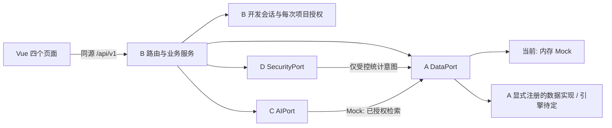

# 架构与职责

> 当前 B 不指定数据库，工厂仅在显式 DataBinding 下使用持久化实现；未注册拒绝启动。历史 SQLite 模块保留但不默认绑定。当前架构和生命周期以 [中立接入说明](persistence-integration.md) 为准。

Phase 1 提供可运行的业务骨架与稳定交接边界。Phase 2B 提供数据库中立注册，Phase 2C 提供任务恢复；Phase 3 补齐 C/D 显式工厂、共享契约与三方交接。默认三模块 Mock，成员实现后可逐一替换；入口及测试见 [统一开发指南](development-guide.md)。正式持久化恢复、安全网关和真实 AI 待实际验收，开发会话仍在内存。



## 目录

```text
backend/app/
  schemas.py             公共数据结构
  config.py              配置及运行模式校验
  main.py                应用装配、请求编号、安全响应头、日志
  auth.py                开发会话、实时成员和负责人校验
  errors.py              脱敏错误响应
  routes/                identity/projects/literature/research/security
  services.py            任务编排、引用检查、网关接入及审计
  adapters/ports.py      A/C/D 的 Protocol 与内部上下文
  adapters/factory.py    唯一适配器装配点
  adapters/mock_*.py     合成开发实现
  persistence/           SQLite 连接、关系映射、26 方法适配器及版本化迁移
backend/tests/           API、权限与契约测试
frontend/src/
  api/schema.d.ts         自动生成，禁止手改
  api/client.ts           基于 OpenAPI 的类型化客户端
  pages/                 四个页面
  components/            统一状态与来源展示
contracts/               导出契约、逐操作与场景示例
scripts/                 契约生成及本地启动
docs/                    架构、接口、交接及验证记录
```

## 依赖和数据流

业务服务只依赖 `DataPort`、`AIPort`、`SecurityPort`，不导入 Mock 类。工厂使用显式 DataBinding 和 C/D 工厂；未注册的持久化或 real 模式均拒绝启动，无 Mock 回退。真实实现与测试 provider 由对应成员交付。

- A 负责数据结构、迁移、约束、事务及项目隔离数据读取。B 不引用 A 的内部表名或 ORM 模型。
- C 返回结构化检索和生成结果。B 校验引用及 Schema，再通过 A 保存；C 不保存报告版本、不执行 SQL。
- D 负责真实策略、SQL 解析、受限执行与关键审计。B 只传递可信身份和项目上下文，不提供 SQL 执行后门。
- 普通 CRUD 由 B 的会话、成员校验与 A 的数据约束保护，不经过动态 SQL 网关。

## 文件与任务

B 保存原始上传文件，使用随机 `paper_id.pdf` 作为存储键，不使用客户端文件名组成路径。C 接收 `FileReference(storage_key, paper_id, project_id)`，不接收用户指定的本地路径或任意 URL。Mock 不读取或解析该文件。

真实 C 同进程时应通过受控文件存储接口读取；远程 C 应使用服务身份认证的文件流或项目绑定、短时有效的一次性访问方式。此传输机制尚待实现，不能把磁盘目录公开为静态站点。文件下载、访问令牌、病毒扫描、扫描件/加密 PDF 识别均未实现。

外部任务编号由 B/A 创建，C 使用相同 task_id 与 request_id；若 C 有内部任务编号，应以明确的关联字段映射。B 的 worker 将 pending 更新为 processing，调用 C，验证返回值后更新 succeeded 或 failed。任务接口返回当前状态，页面轮询。失败重试复用 task_id，领取时增加 attempts；Mock 和 SQLite 均遵循 AB-1 尝试隔离。

SQLite 已提供基础事务式 claim、租约恢复和幂等提交，避免旧尝试重复写入片段；正式库并发、多进程和可靠队列仍需 A 验证和完善。

## 身份与信任边界

开发登录仅选择预置身份；不是密码校验。B 保存随机会话标识，浏览器仅持有 HttpOnly Cookie。每次读取重新查询 A 的成员关系，移除成员立即失效。项目编号和请求编号都不构成授权凭据。

论文、任务、报告等子资源都按当前项目校验。检索调用前限定项目，Mock 数据访问也限定项目。返回片段必须与该项目当前可访问片段匹配。报告保留引用快照，移出论文前需要确认；移出后普通检索、论文详情和相关任务读取被拒绝，历史报告仍按项目权限读取。

## 查询与审计

统计入口仅调用 `SecurityPort.execute`。Mock Security 根据三条固定自然语言匹配受控统计；数据端可为内存或三种固定的参数化 SQLite 查询，没有模型生成 SQL 的解析执行链路。任何网关异常、缺失授权或关键审计故障都返回错误，不切换到数据层执行。

B 向 A 写入业务审计；D 对真实 SQL 网关内策略与执行阶段的审计负责，并复用 A 的追加写能力。B 在网关调用前后记录请求及结果；真实 D 仍须保证自身关键审计写入失败不执行查询，不能依赖 B 的事后记录代替此保证。

登录审计的 project_id 可为空，仅内部记录，不通过项目审计页暴露。项目审计列表仅负责人可读，按项目、动作、决策、用户和时间筛选。没有对外修改或删除审计的接口；内存 Mock 不具备数据库防篡改能力。

日志仅包含请求编号、路由模板、方法、状态码和耗时；不记录请求正文、Cookie、模型密钥、SQL 或论文正文。
