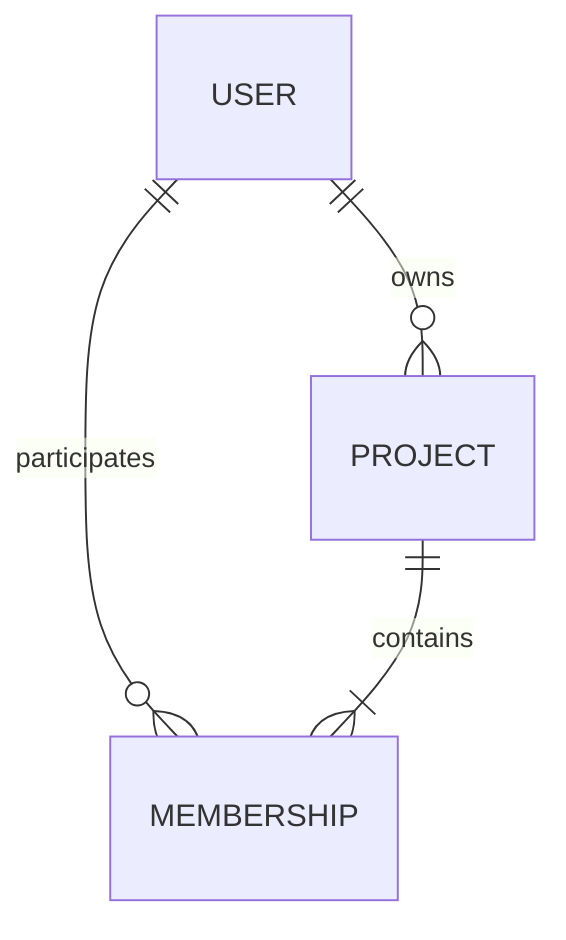
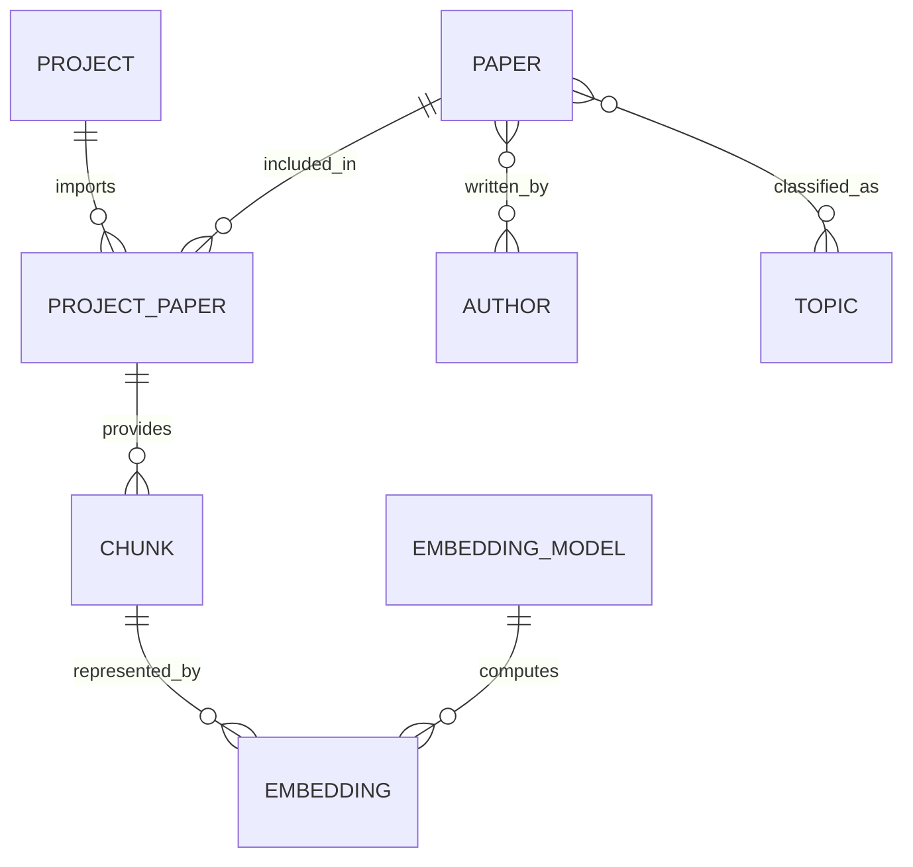
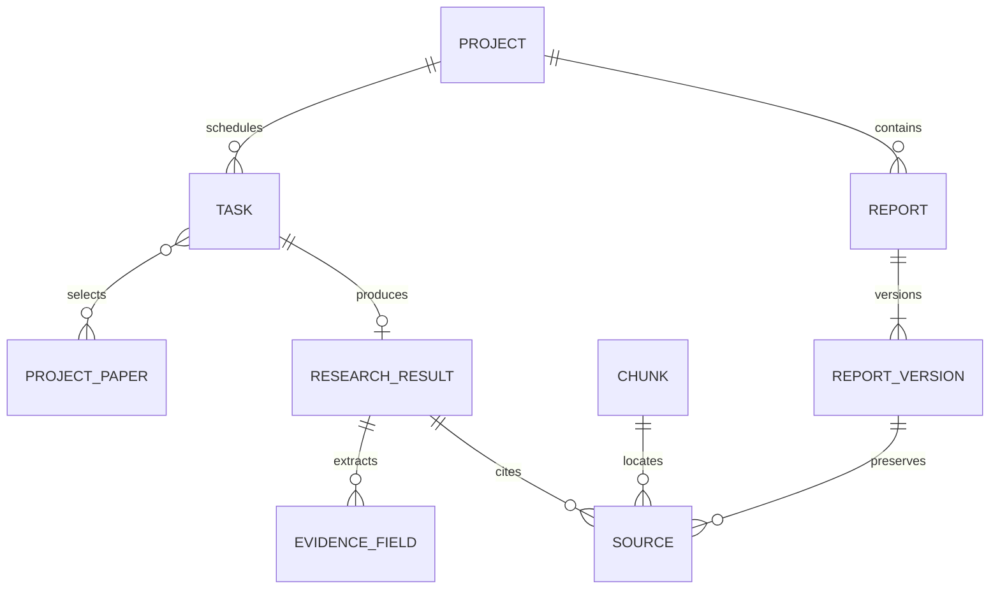
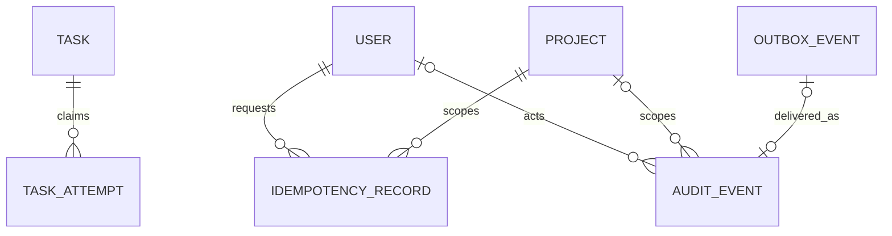

# 明确需求并生成分 E-R 图

## 1 需求来源和范围

依据 PRD 第六章、9.2 节及 [AB-1](../ab-data-contract.md)、[A 交接说明](../member-a-handoff.md)、`backend/app/adapters/ports.py`、`backend/app/schemas.py` 和 `backend/app/adapters/data_rules.py` 建模。以现有 26 个 DataPort 方法的公开语义为兼容基线；不新增 HTTP 字段或第二套用户身份。

| 编号 | 业务需求 | 主要数据及约束 | 追溯位置 |
| --- | --- | --- | --- |
| R01 | 预置用户进入自己参与的项目 | 用户唯一；项目与用户多对多；一项目一负责人 | PRD FR-01；AB-1 用户与成员 |
| R02 | 负责人管理成员，撤销后立即失去访问权 | 角色属于成员关系；历史操作者不能依赖当前成员行存活 | AB-1 P-member/P-owner |
| R03 | 导入论文并创建任务 | 项目内摘要唯一；文件引用、导入记录、任务和幂等记录原子提交 | PRD FR-02；AB-1 T-import |
| R04 | 同一文件可导入不同项目 | 每次项目导入有独立 paper_id；移出后摘要仍占用 | AB-1 核心实体、唯一性 |
| R05 | 按年份、主题查询，保留作者关系 | 论文与作者、主题均为多对多；年份可空 | PRD 6.1/6.3；AB-1 controlled_statistics |
| R06 | 来源定位到论文、页码及片段 | chunk_id 全局唯一；页码从 1 开始；citation_id 只在当前结果作用域有效 | PRD FR-03/05；C 交接说明 |
| R07 | 提取五类证据和带引用的问答/草稿 | 结果与来源必须同项目、在任务范围内；证据不足可成功返回 | PRD FR-04/05/06；complete_job |
| R08 | 异步任务失败可重试、崩溃可恢复 | 同 task_id；领取次数单调增加；旧尝试不能覆盖新结果 | AB-1 T-retry/T-claim/T-complete |
| R09 | 保存不可覆盖的报告版本 | 版本唯一、基础版本比较、正文和引用快照同事务 | PRD FR-06；AB-1 T-report |
| R10 | 移出论文仍能读取授权历史报告 | 当前文献读取失效；历史快照保留；失去项目成员资格则仍不可读 | AB-1 removal_hides_live_resources |
| R11 | 重试不产生重复导入或版本 | 幂等键按用户/项目/操作分区；同键异参冲突；重放重新授权 | AB-1 唯一性与幂等 |
| R12 | 数据库限制动态查询并保留审计 | 项目边界、受限身份、审计不可由普通账户改删、事件可关联请求 | PRD FR-07/08；D 交接说明 |
| R13 | 业务提交与最小领域审计一致 | 业务事务同时写入 outbox，投递重试按 event_id 去重 | AB-1 事务边界 |

## 2 实体和联系识别

独立标识、生命周期和可被引用的业务对象识别为实体。用户参与项目、论文具有作者/主题是多对多联系；报告版本、片段和证据属于有独立字段及历史意义的从属实体。状态、页码和耗时是属性，不各自建实体。文件保存为不透明引用，不把本地绝对路径或文件内容混入授权实体。

划分四个局部视图：V1 身份与项目，V2 文献与来源，V3 研究与报告，V4 运行控制与审计。以下先保留各视角的自然称呼，不在局部建模时强行统一“论文”“来源”“角色”的含义；这些歧义在合并后逐项处理。

## 3 V1 身份与项目分 E-R 图

| 对象或联系 | 局部属性 | 规则 |
| --- | --- | --- |
| USER 用户 | user_id、username、display_name | username 唯一；密码摘要/禁用机制待 A/B/D 对齐 |
| PROJECT 项目 | project_id、name、description、owner_id | 名称不唯一；每项目恰好一位负责人 |
| MEMBERSHIP 成员关系 | user_id、project_id、role | 用户在同一项目最多一条关系；角色 owner/member |

负责人也必须是成员，且是该项目唯一 owner。不能将 owner/member 当作用户的全局属性。概念图的 `owns` 与成员关系中的 owner 是同一事实的两种观察，后续需要一致性约束，不能维护两套互不相关的权限。

## 4 V2 文献与来源分 E-R 图

| 对象或联系 | 局部属性 | 规则 |
| --- | --- | --- |
| PAPER 论文书目 | 论文标识、标题、年份 | 本视图初步允许书目被多个项目导入，尚未决定共享边界 |
| PROJECT_PAPER 项目导入 | paper_id、project_id、digest、storage_key、状态、导入人 | 公开 paper_id 指项目导入；同项目摘要唯一 |
| AUTHOR / TOPIC | 作者编号、姓名；主题编号、名称 | 多对多；作者顺序属于论文作者联系 |
| CHUNK 原文片段 | chunk_id、页码、顺序、摘录、正文、synthetic | 片段归属项目导入；完整正文不等于 Source.excerpt |
| EMBEDDING / EMBEDDING_MODEL | 向量；供应方、模型名、版本、维度、距离度量 | 与 C 确认；今日 3 维只用于独立预验证 |

一个导入记录可以暂时没有片段，处理成功后才可检索。关键词/向量索引的真实完成条件需要与 C 对齐，不以写入合成摘录替代真实索引完成。

## 5 V3 研究与报告分 E-R 图

| 对象或联系 | 局部属性 | 规则 |
| --- | --- | --- |
| TASK 任务 | task_id、类型、状态、问题、论文范围、操作者、request_id | process/answer/evidence/draft；每任务最多一个已提交结果 |
| RESEARCH_RESULT 结果 | 类型、回答/草稿、evidence_id、证据不足标志、结果来源 | 结果是类型联合，不用任意字符串表示可执行数据库操作 |
| EVIDENCE_FIELD 证据字段 | 字段名、文本、状态、支撑来源 | 每份证据结果包含固定五类字段，允许未提及/证据不足 |
| SOURCE 来源 | citation_id、paper_id、chunk_id、page_number、excerpt、synthetic | 局部图尚将实时引用与历史快照视作同类对象 |
| REPORT / REPORT_VERSION | report_id；version_id、number、标题、问题、正文、创建时间 | 报告至少一版；保存新版本不能覆盖旧版 |

SOURCE 不是独立的“全局引用编号库”；结果内编号可能重新分配。局部图中 SOURCE 同时承担实时来源和历史快照，合并后必须解决它们的生命周期冲突。

## 6 V4 运行控制与审计分 E-R 图

| 对象或联系 | 局部属性 | 规则 |
| --- | --- | --- |
| TASK_ATTEMPT 执行尝试 | task_id、attempt_no、领取/到期时间、可信上下文、结束状态 | 一个任务可多次领取；单次租约到期不等于删除任务 |
| IDEMPOTENCY_RECORD 幂等记录 | 用户、项目、操作、键、指纹、原始响应快照 | 不是只按 request_id 去重；演示期保留，不自动清理 |
| AUDIT_EVENT 审计 | event_id、时间、request_id、用户/项目、动作、决策、策略、执行状态、耗时 | 登录事件用户/项目可空；event_id 唯一，request_id 不唯一 |
| OUTBOX_EVENT 领域事件 | event_id、最小事件载荷、投递次数/时间 | 与业务同事务；仅部分审计来自 outbox，D 还有直接追加事件 |

图中 OUTBOX_EVENT 到 AUDIT_EVENT 是投递关联，未必为实体外键：事件投递前审计尚不存在，审计也可由 D 独立追加。最终关系模式以 event_id 做幂等关联，不强制每条审计必须来自 outbox。

## 7 阶段检查

R01—R13 均已有局部视图承载；保留三项关键歧义进入下一阶段：共享 PAPER 的范围、SOURCE 与快照是否同一实体、owner 与成员角色是否重复。后续先合并概念总图，再记录决策及最终关系模式。
