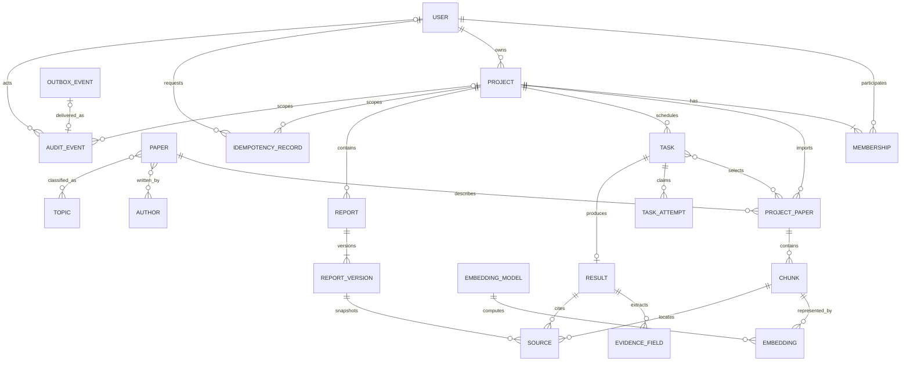

# 合并初步总 E-R 图

本阶段仅做实体对齐和联系合并，不把尚有歧义的局部模型冒充最终模型。输入为 [四个分 E-R 图](01-requirements-and-local-er.md)，输出为下面的合并草图及冲突清单，之后进入 [冲突消解](03-resolved-model.md)。

## 1 合并对应表

| 各分图中的对象 | 合并对象 | 合并依据 | 待解决问题 |
| --- | --- | --- | --- |
| V1/V2/V3/V4 PROJECT | PROJECT | 同一 project_id 和项目生命周期 | 所有从属实体的项目边界需统一 |
| V1/V4 USER | USER | 同一 user_id；现有唯一用户模型 | 数据库登录角色不等于业务用户 |
| V2/V3 PROJECT_PAPER | PROJECT_PAPER | 相同公开 paper_id | 不与全局书目编号混用 |
| V2/V3 CHUNK | CHUNK | 相同 chunk_id 和页码定位 | 移出项目后保留历史定位但限制实时访问 |
| V3/V4 TASK | TASK | 相同 task_id | task 状态与 attempt 状态需区分 |
| V3 SOURCE | SOURCE | 来源属性表面相同 | 结果内编号、证据字段内编号及版本快照不是同一生命周期 |
| V3 RESEARCH_RESULT/EVIDENCE_FIELD | RESULT / EVIDENCE_FIELD | 证据是结果的一种类型 | result_ref 的不同类型不能建立一个伪外键 |
| V4 AUDIT_EVENT/OUTBOX_EVENT | 两个实体保留 | 一个是审计事实，一个是待投递事件 | 投递状态可更新，审计内容应不可变 |

## 2 初步合并总图

## 3 合并后发现的冲突

| 类别 | 冲突 | 不处理的后果 |
| --- | --- | --- |
| 命名 | PAPER 的“论文编号”与 PROJECT_PAPER 的 paper_id 同名异义 | 通过编号误访问另一项目 |
| 命名 | Source、Chunk、Citation 被当作同一个对象 | 将临时引用编号误当全局主键 |
| 属性 | owner_id 与成员 role=owner 重复表达负责人 | 两套负责人不一致 |
| 属性 | 年份可空、显示状态、移出状态和索引状态混淆 | 未知年份被伪造，移出后仍能检索 |
| 属性 | embedding 维度在 Mock 中不存在 | 将临时 3 维写死为真实模型设计 |
| 属性 | citation_id 在五个证据字段中可分别出现 | 过度唯一约束拒绝合法结果 |
| 结构 | 共享书目元数据与项目独立授权冲突 | 一项目编辑/删除影响另一个项目 |
| 结构 | SOURCE 同时属于当前结果和历史版本 | 移出论文或重新处理后历史报告改变 |
| 结构 | 任务与尝试一对多，但任务只有一套结果字段 | 迟到 worker 覆盖重试结果 |
| 结构 | result_ref 可指论文、证据或任务编号 | 无法用一个普通外键保证类型和归属 |
| 结构 | 物理删除成员与历史操作外键冲突 | 撤权导致任务/审计/报告无法保留 |
| 结构 | 审计不可变与 outbox 投递状态可变冲突 | 审计保护失效或事件不能重试 |

这些冲突按 C01—C15 在下一文档逐项消解。只在有明确依据的地方作设计决策；跨成员未决事项列入协作表，不伪称已得到 C/D 确认。
