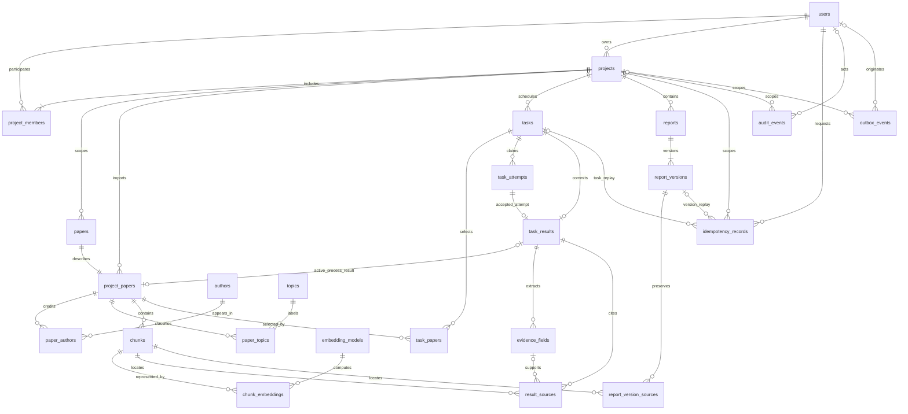

# 解决冲突并形成最终关系模型

## 1 冲突消解记录

“确定”表示依据现有 PRD/AB-1 固定；“A 设计”表示本次提出的内部实现方案，下一步写迁移时落实；“待协作”不作为已经实现或团队批准的能力。

| 编号 | 类别 | 冲突与处理 | 依据或状态 |
| --- | --- | --- | --- |
| C01 | 命名 | 公开 paper_id 固定为项目导入编号；内部书目用 metadata_id，不复用同一名字 | AB-1，确定 |
| C02 | 结构 | 首版每次导入独占一份 papers 元数据，和 project_papers 提交后一对一；跨项目不共享作者、主题、片段或向量 | A 设计，避免共享内容越权；不影响同文件跨项目导入 |
| C03 | 属性 | owner/member 属于项目成员关系；projects.owner_id 用可延迟复合外键指向唯一 owner 成员 | AB-1 + A 设计；规则 K02 |
| C04 | 命名/结构 | Chunk 是稳定片段；Source 是带 citation_id 的上下文来源视图；不建“全局 citation_id 表” | C 交接说明，确定 |
| C05 | 属性 | 根结果的引用按 task_id+scope+引用编号唯一；证据每字段独立 scope，同一编号在不同字段可重复 | 现有 complete_job 按字段校验；不得擅自收紧 AB-1 |
| C06 | 结构 | task_results/result_sources 和 report_versions/report_version_sources 分开；版本保存完整值快照，不动态拼接最新内容 | AB-1 历史不可变，确定 |
| C07 | 属性 | year=NULL 表示未知；处理状态、removed_at、index_state 分列；用 active_process_task_id 指向当前解析来源集合，旧片段只供历史定位 | AB-1 + A 设计，避免重复解析混入旧来源 |
| C08 | 结构 | tasks 保存当前状态；task_attempts 保存每次领取的可信上下文与租约；结果注明 committed_attempt | AB-1，确定；租约细节待 A/B |
| C09 | 结构 | result_ref 按 kind 派生：process→paper_id，evidence→evidence_id，answer/draft→task_id；不建指向多表的虚假外键 | 现有 Mock/Schema，确定 |
| C10 | 属性 | 用户/项目/操作/key 为幂等键；request_id 只关联日志；保存原始响应快照以支持准确重放 | AB-1，确定 |
| C11 | 结构 | 历史 actor/creator 外键指 users，而不是 project_members；撤销成员不级联删除历史 | AB-1 撤权与历史规则，确定 |
| C12 | 属性/结构 | 独立 embedding_models 和 chunk_embeddings，模型版本及维度受控；不把预验证 3 维当正式约定 | A 设计，实际模型、载荷、索引提交面待 C |
| C13 | 结构 | audit_events 只追加；outbox_events 独立保存投递状态；event_id 关联但不强制双向外键 | AB-1，A/D 投递机制待协作 |
| C14 | 结构 | 多对多联系展开为关联表；项目子实体用带 project_id 的复合外键，不能仅有独立 UUID 外键 | A 设计；关系模式见数据字典 |
| C15 | 命名/权限 | 业务 User/项目角色与 PostgreSQL 登录角色分开；不以客户端或可任意改写的会话变量作为最终授权 | PRD/AB-1；可信数据库上下文机制待 D |

## 2 冲突消解后的总 E-R 图

这是映射后的总图，包含 24 张逻辑表。概念多对多联系已经展开，Source 分拆为结果来源与版本来源，运行控制实体也单独保留。图显示主要联系；所有字段级复合外键、辅助唯一键及可空性以 [数据字典](04-data-dictionary.md) 为准。每项目一个 owner、每报告至少一版、每份证据恰好五字段，属于需额外保证的提交后业务基数，不能只凭图中的“多”表达。

outbox_events 与 audit_events 按相同 event_id 幂等投递，未画成强制外键联系。用户、项目到作者/主题/模型等的辅助外键省略绘制，不代表这些表可以跨项目访问。

## 3 关系模式与规范化

实体身份由 UUID 主键确定；成员、作者关联、主题关联、任务论文关联和来源使用复合键。普通属性依赖其实体键，多对多不放入逗号分隔字符串。五类证据采用固定字段名的从属行，不把缺失字段静默省略。作者姓名不是可靠身份键，不以同名自动合并作者。

所有项目子表显式携带 project_id，是为复合外键和未来 RLS 保留的受控冗余；结果 JSON、幂等响应和报告来源是有意保留的不可变快照，不能宣称这些副本自动保持一致。typed 字段、关联行和快照必须在同一事务经格式/引用校验后提交，读时由适配器按既有 Schema 装配。

公开 Source 的 citation_id、page_number、excerpt 和 synthetic 必须保真。任务结果可保存完整 JSONB 快照，但项目、任务、论文、片段、证据字段及报告关联仍以关系键约束，不能仅将整套系统塞入无外键的 JSON 字段。

## 4 主键外键和完整性约束

下表是待迁移实现的约束清单，不是已经通过的数据库测试。跨行/跨表规则不能写成普通 CHECK；需要延迟外键、约束触发器，或锁定事务配合可信写入入口。

| 编号 | 约束 | 拟落实位置 |
| --- | --- | --- |
| K01 | 用户名唯一；用户名 1—64；项目名 1—100，描述最多 1000 | users/projects 的 UNIQUE、NOT NULL、CHECK；display_name 不额外收紧公开契约 |
| K02 | 项目恰好一位负责人，负责人也是成员 | members PK(project_id,user_id)；UNIQUE(project_id,user_id,role)；部分唯一索引 project_id WHERE role='owner'；projects 的 (project_id,owner_id,owner_role) 延迟 FK 指向成员复合键，owner_role 固定 owner |
| K03 | 负责人不可移除或转让；成员重复添加不降级 | K02 防删除/改角色；projects.owner_id 不可变触发器；add_member 冲突时返回原成员 |
| K04 | 项目内同摘要唯一，移出后仍唯一；元数据导入一对一 | project_papers UNIQUE(project_id,digest)、UNIQUE(metadata_id)；papers/project_papers 的反向存在性由提交前约束触发器保证 |
| K05 | 项目归属一致 | 数据字典所列 (project_id,资源键) 复合 FK；被引用端建立对应完整 UNIQUE 键，不能引用部分唯一索引 |
| K06 | 摘要与状态合法 | digest 为 64 位小写十六进制；year 为 NULL 或 1000—3000；paper/task/attempt/index 使用分别定义的枚举 CHECK |
| K07 | 片段稳定且可定位 | chunk_id PK；一次 process 的来源序号为 result_sources.ordinal；page_number≥1；摘录 1—4000；已提交片段不原位改正文/页码/归属；当前来源只取 active_process_task_id 对应集合 |
| K08 | 尝试次数与结果一致 | attempts≥0；attempt_no≥1；结果复合 FK 指向实际尝试；领取/完成用状态和上下文条件更新，并锁任务行；租约过期不能重用旧尝试号 |
| K09 | 任务范围和结果类型匹配 | process 恰好一篇且文件引用一致；evidence 恰好一篇；answer/draft 可空。行数、载荷与 kind 的跨表校验由提交前约束触发器及适配器校验落实 |
| K10 | 证据与引用合法 | evidence_id 非空时全局唯一；证据恰好五字段；scope/root/字段对应关系受约束；来源与任务范围、实际片段的页码/摘录/synthetic 一致由数据层重验 |
| K11 | 报告版本不可覆盖且不产生分叉 | version_id PK、UNIQUE(report_id,number)、非空 base_version_id 的 UNIQUE(report_id,base_version_id)；首版 base=NULL、number=1；报告 current_version 延迟 FK；锁 reports 行做 CAS；延迟约束触发器验证连续版本和最新指针 |
| K12 | 幂等不能越权或重复创建 | PK(user_id,project_id,operation,key)；相同规范化指纹重放原响应；同键异参返回冲突；演示期 expires_at=NULL；重放仍检查最新权限 |
| K13 | 审计唯一且可去重 | event_id PK；duration_ms≥0；带时区时间；同 event_id 的完整规范化事件指纹一致才允许空操作 |
| K14 | 引用、报告和审计不级联丢失 | 历史相关 FK 默认 NO ACTION；论文只设置 removed_at；成员物理删除但历史用户引用保留；普通业务入口无硬删除项目/用户/论文/片段功能 |
| K15 | 真实向量不得与模型元数据不一致 | chunk_embeddings.dimensions 与 embedding_models 复合 FK；CHECK(vector_dims(embedding)=dimensions)；模型维度与版本记录不可原位更改，新增模型记录迁移 |

K02、K04、K11 的循环引用需要同一事务创建相关行，延迟到提交时检查；迁移时先建表及完整候选键，再添加循环外键/约束触发器。不要试图用引用另一张表的 CHECK 实现这些规则。

## 5 事务与并发边界

| 事务 | 原子提交对象及并发要求 |
| --- | --- |
| 创建项目 | projects + owner 成员 + outbox；不把 request_id 当创建项目幂等键 |
| 修改成员 | 锁定关系并更新；撤权后下一次资源访问重新检查；历史 actor 不删 |
| 导入论文 | papers + project_papers + tasks + task_papers + 幂等响应 + outbox；唯一冲突后无半条论文/任务 |
| 领取任务 | 锁可领取任务行，递增 attempts，新建 task_attempts，更新任务/处理论文状态和租约；多 worker 不可领取同次尝试 |
| 重试/租约恢复 | retry_task 只接受 failed→pending，复用 task_id；恢复过期 processing 时封存旧尝试再创建更大尝试号；不承诺外部 AI 恰好调用一次 |
| 完成/失败 | 对 task_id+attempts+user_id+project_id+request_id+kind+payload 指纹重验；成功写结果/来源/证据、任务和论文状态、outbox，process 同时切换 active_process_task_id；失败不留研究半成品；同次同结果可重放 |
| 保存报告 | 锁报告行，比较 base_version_id；正文、版本号、引用快照、当前指针、幂等响应和 outbox 同事务；并发旧基础版本返回 VERSION_CONFLICT |
| 审计投递 | outbox 事件内容与业务同事务，投递单独重试；append_audit 按 event_id 去重；D 的查询执行前关键审计不靠事后 outbox 替代 |

文件写入和外部模型调用不在数据库长事务中。明确回滚映射 DATA_UNAVAILABLE；提交结果不明映射 DATA_COMMIT_UNKNOWN，保留原幂等键对账，不能错误删除已采纳文件。锁模式、租约续期和投递器将在实现阶段验证，本次没有运行这些并发实验。

## 6 删除保留和访问规则

1. 移出论文仅更新 removed_at，不释放项目摘要、不删片段。列表、检索、当前来源、证据及引用该论文的普通任务接口不再返回它。
2. 已保存版本从 report_version_sources 读取冻结值，并按当前项目成员资格授权；不会因移出论文而变更。同一已保存请求的幂等重放可读原版本，新请求不能利用旧片段新建报告。
3. 撤销成员删除当前成员关系，任务/版本/审计的操作者仍引用 users；被撤权 worker 不能提交研究结果，但可按 AB-1 安全关闭旧尝试。
4. 业务角色不拥有表，不是超级用户、没有 BYPASSRLS；后续 D/A 应配置受控视图、RLS 与可信上下文。复合 FK 防止错误关联，不会自动阻止未授权 SELECT，不能代替 RLS。
5. 仅项目负责人可读完整项目审计；普通成员也不能随意读取用户全表或其他项目的作者/主题/模型元数据。审计/outbox 载荷不存令牌、密码或完整论文正文。

## 7 查询与候选索引

唯一键会带来对应索引；其余索引为候选方案，不能当作已经完成性能优化。

| 访问路径 | 候选索引/关联 |
| --- | --- |
| 用户项目列表 | project_members(user_id,project_id)，联 projects |
| 项目论文及年份 | project_papers(project_id) WHERE removed_at IS NULL；papers(project_id,year,metadata_id)，联元数据 |
| 来源与报告追溯 | chunks(project_id,paper_id,chunk_id)；当前来源从 active_process_task_id 联 result_sources；result_sources/report_version_sources 的项目、父资源及顺序键 |
| 任务领取/租约恢复 | tasks(status,created_at,task_id) 的 pending 部分索引；task_attempts(lease_expires_at) 的 processing 部分索引 |
| 年份/主题/缺证据统计 | 项目论文联 papers；paper_topics(project_id,topic_id,paper_id)；task_results(project_id,paper_id) WHERE kind='evidence' |
| 最新报告/版本 | reports(project_id,report_id) 与 current_version_id；版本 UNIQUE(report_id,number) |
| 项目审计筛选 | audit_events(project_id,timestamp DESC,event_id DESC)；按实测再决定 actor/action/decision 复合索引 |
| outbox 重投 | outbox_events(next_attempt_at,created_at) WHERE published_at IS NULL |
| 全文/语义检索 | C 确认正文和语言配置后决定全文 GIN；真实模型和维度确定后评估逐模型向量索引，不使用验证用 3 维索引代替 |

## 8 待协作事项和非阻塞设计边界

| 负责人 | 尚需确认 | 本设计如何处理 |
| --- | --- | --- |
| A/B/D | 正式认证、密码摘要、用户禁用、会话持久化 | 只保留一张 users；认证字段/会话表不擅自冻结或新增公开方法 |
| A/C | 完整正文、分片顺序、模型版本、维度、向量私有提交面、索引完成原子性 | 保留 chunks 正文和模型/向量关系；不改 ProcessResult，不以其仅有的 Source 假装完整载荷 |
| A/C | 作者/主题的写入结构和主题统计口径 | 多对多结构确定；建议每论文每主题一次计数，是否纳入无主题桶待确认 |
| A/B | 租约续期、最大重试、未知提交对账和孤立文件 | 基础 attempts/租约/幂等存储确定；演示默认 120 秒且不清理幂等，不预设死信机制 |
| A/D | 可信数据库项目绑定、受控视图、审计保护和投递确认 | 保留 project_id 和 outbox；不把普通可更改 GUC 当成安全边界 |

## 9 设计检查与依据

设计完成条件：R01—R13 有实体承载；四分图先合并再消解冲突；24 张表均有数据字典；26 个 DataPort 方法均有落点；不改变公开 Schema；普通外键、跨行规则和应用校验责任区分清楚。下一步迁移必须用真实数据库验证 K01—K15，文档检查不等于约束实测通过。

PostgreSQL 16 的实现依据：[完整性约束及 CHECK 边界](https://www.postgresql.org/docs/16/ddl-constraints.html)、[可延迟约束触发器](https://www.postgresql.org/docs/16/sql-createtrigger.html)、[RLS 与绕过角色边界](https://www.postgresql.org/docs/16/ddl-rowsecurity.html)。这些机制支持上述设计选择，但没有替本项目完成实现或安全验收。
