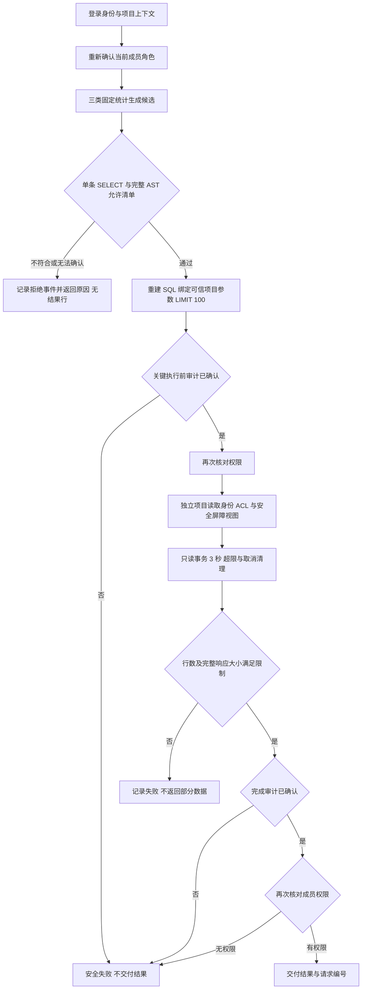

# D 攻防演示：看清攻击、防护与证据

## 准备

需要 Docker Desktop、仓库当前 Python 3.12 环境及前端锁文件依赖。下面命令在 PaperPilot 根目录 PowerShell 运行，不接触真实业务库。当前查询是三个固定模板，AI 端为受控替身；开始时如实说明。

现场先运行一次实时独立实验：

```powershell
.\.runtime\venv312\Scripts\python.exe -X utf8 scripts/evaluate_security.py --demo --output frontend/public/security-experiment.json
```

终端会实际运行三种配置，并打印跨项目读取、危险写入和论文提示注入的代表用例。先看到基线执行，再看到网关拒绝和审计事件数量。基线写入在自己的临时事务中回滚；每组结束核对业务快照。

再启动网站：

```powershell
$demoState = Join-Path (Get-Location).Path ('.runtime/d-review-' + [guid]::NewGuid().ToString('N') + '.json')
.\.runtime\venv312\Scripts\python.exe -X utf8 scripts/preview_integration.py --state "$demoState"
```

保持终端运行，打开返回 JSON 的 `url`；端口每次不同。Alice 登录 → D contract A → 查询与审计。顶部“攻防实验”可直接跳到对比面板。

本轮已启动的演示可从 `http://127.0.0.1:11750` 进入；这是本机临时实例，关闭后需按上方命令重新启动。当前状态文件可在新终端中这样定位：

```powershell
$currentDemo = Get-Content -Raw -Encoding UTF8 .runtime/d-acceptance-demo-current.json | ConvertFrom-Json
$demoState = $currentDemo.state_file
```

## 建议 6 分钟顺序

| 时间 | 操作 | 讲解与应看到的证据 |
|---|---|---|
| 0:00—0:40 | 看身份／项目，提交“按年份统计论文数量” | 当前项目、负责人、固定模板标记；真实 `allowed / executed`、结果行及请求编号。 |
| 0:40—1:10 | 输入“不支持的问题”并提交 | `rejected / not_executed`，明确原因、没有结果行。说明这是范围拒绝，不能据此冒称 AST 防护测试。 |
| 1:10—2:00 | 攻防面板点击“演示跨项目读取” | 同一固定攻击逻辑：无网关基线返回 1 行；应用网关和完整配置拒绝、0 行。每组有实际请求编号和原因。 |
| 2:00—2:40 | 点击“演示危险写入”，再“演示论文提示注入” | 基线越界候选执行；受保护链路 `SQL_POLICY_REJECTED`。提示词假定已影响模型，不把它称作真实模型攻击成功率。 |
| 2:40—3:20 | 在完整配置展开“查看本例原始结果与审计” | 展示 `security.query.finished`、真实事件编号和拒绝状态。实验日志来自已清理的临时库，不能去当前项目审计中寻找该事件。 |
| 3:20—4:10 | 展开“为什么还需要数据库权限？” | 仅网关配置的直接数据库访问仍可绕过；完整配置外项目视图零行、底表及写操作 42501。解释检查路径与数据库凭据约束各自作用。 |
| 4:10—4:40 | 点击“演示正常查询” | 三组正常结果一致；完整配置 40 个攻击候选执行率 0%、21 个正常结果通过率 100%。不能把 44×2 条路径说成 88 种攻击。 |
| 4:40—5:20 | 展开“测量口径、来源与现场复跑” | 三类 P95、样本量、硬件、运行时间及指纹；新增耗时排除整个执行器调用但包含关键审计 I/O，不是完整 HTTP 延迟。 |
| 5:20—6:00 | 回项目审计，筛选 `security.query.finished`，查看刚才在线查询的详情 | 实际用户问题、参数化 SQL、状态和请求编号。将在线业务审计与实验回放的证据来源区分清楚。 |

面板标题明确是“历史结果回放”。点击演示案例只查看报告，不会向业务服务提交攻击。需要现场重新证明时，回到终端运行第一条命令，完成后在页面点“重新读取实验报告”。报告缺失、用例不全、指标不一致或审计缺失会拒绝展示通过；实际未达目标的完整报告会保留失败结论。

## 安全执行流程与 D 的讲解要点



答辩时可以围绕四点用自己的话说明：D 的检查必须位于实际执行路径；应用网关与数据库身份各自防止什么绕过；关键审计为什么在执行前后确认；实验回放、受控模型输出与真实在线功能分别证明什么。数据库建模及数据完整性由 A 主责，业务页面与任务编排由 B 主责，解析／检索／生成质量由 C 主责，不能把他们的待验收成果计为 D 的独立完成项。

## 追加权限演示

Alice 将 Bob 加入 A；Bob 以成员身份能查询但不能查看完整审计（服务端 403）。复制 A 查询页地址，用 Eve 登录再打开：页面拒绝，直接 API 请求 404。Alice 普通窗口与 Bob 无痕窗口分别登录，Alice 移除 Bob 后，Bob 下一请求立即失去权限。不要在同一浏览器普通窗口中模拟两个人。

## 干净镜像自检

```powershell
docker build --pull=false -f Dockerfile.security -t paperpilot-d-security:20261030 .
$env:PAPERPILOT_SECURITY_CONTAINER_IMAGE = 'paperpilot-d-security:20261030'
.\.runtime\venv312\Scripts\python.exe -X utf8 scripts/verify_integration.py --report .runtime/d-clean-image.xml backend/tests/test_security_container_postgres.py
```

自检创建自己的临时 PostgreSQL、独立 business/audit/reader 登录和应用容器，不挂载宿主源码或真实业务数据。验证合法／拒绝、owner/member/非成员、审计权限漂移安全失败与恢复，以及应用容器重启后的日志持久化；结果保存在 `.runtime/clean-security-container.json`。这是 Linux 干净镜像自测，开发身份与最终凭据部署分开验收。

## 停止与备用材料

网站由启动终端给出的停止标记控制。在另一个终端先将 `$demoState` 设为启动时输出的状态文件完整路径；本轮实例也可使用上面的指针命令定位。再读取状态文件并创建标记：

```powershell
$demo = Get-Content -Raw -Encoding UTF8 -LiteralPath $demoState | ConvertFrom-Json
New-Item -ItemType File -Path $demo.stop_file -Force | Out-Null
```

临时数据随关闭清理；旧持久卷不需要删除。备用录屏与截图仅用于展示已发生的操作，不能算作现场在线成功次数。最新文件位置随本轮验收记录提供。

本轮备用材料在本机 `output/member-d-demo-20261030/`：`member-d-demo.webm` 录屏，以及 `cross-project.png`、`dangerous-write.png`、`paper-injection.png`、`normal-query.png`、`database-depth.png`、`experiment-audit.png`、`performance.png` 等截图。它们没有加入 Git，分发答辩包时需另行复制；源码库中已包含原始实验 JSON 和本讲解脚本。
