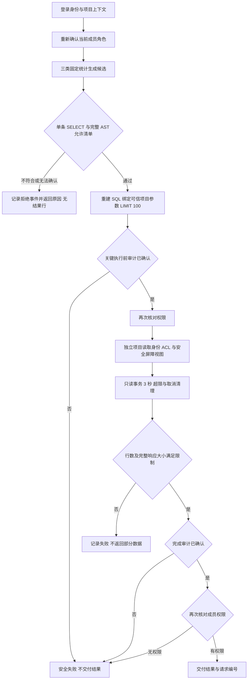

# D 攻防演示：看清攻击、防护与证据

## 准备

需要 Docker Desktop、仓库当前 Python 3.12 环境及前端锁文件依赖。下面命令在 PaperPilot 根目录 PowerShell 运行，不接触真实业务库。当前查询是三个固定模板，AI 端为受控替身；开始时如实说明。

## 从前端实时运行（2026-10-31）

使用下方 `preview_integration.py` 命令启动网站后，Alice 登录 → D contract A → 查询与审计 → 攻防实验，点击“开始实时实验”。无需先在终端运行实验脚本。

按钮会实际执行三组配置下的 40 个攻击、21 个正常查询、三项数据库直接访问及每类 30 次性能测量。页面显示任务编号、三阶段进度、开始及完成时间；结束后展示本次结果，可下载当前结果 JSON。刷新页面后查询进度会恢复同一任务，不会自动重复提交。

实时执行期间隐藏历史通过率；Docker、容器、超时或结果校验失败时显示错误，不以历史成功代替本次结果。切换提示词只选择查看哪条用例；点击实时按钮会执行完整固定集。仍使用受控恶意候选 SQL，不调用真实模型。

启动脚本自动设置 `PAPERPILOT_SECURITY_EXPERIMENTS=1`。普通服务默认关闭此功能；开启后也仅接受本机可信来源、当前项目负责人操作，单实例串行运行，不接收客户端 SQL、数据库凭据、输出路径或 shell 参数。服务关闭和超时会停止实验子进程并按本次任务专属标签清理容器。

本轮实时演示地址为 `http://127.0.0.1:1812`，状态指针为 `.runtime/d-live-demo-current.json`。原 `11750` 实例若仍运行，使用的是之前的后端，不会自动具备实时接口；本轮中途的 `1077` 实例已关闭。新实例的地址和停止标记可这样查询：

```powershell
$livePointer = Get-Content -Raw -Encoding UTF8 .runtime/d-live-demo-current.json | ConvertFrom-Json
$liveDemo = Get-Content -Raw -Encoding UTF8 -LiteralPath $livePointer.state_file | ConvertFrom-Json
$liveDemo.url
# 完成演示后，只停止这个新实例：
# New-Item -ItemType File -Path $liveDemo.stop_file -Force | Out-Null
```

Docker 必须启用 Linux 引擎并准备固定实验镜像；缺少镜像时运行：

```powershell
docker pull pgvector/pgvector@sha256:7b822b0aac60967beb1ea5e576b8602c94c300a157d187f385ae3e0da199b90a
```

终端命令仍可单独使用，生成历史报告：

```powershell
.\.runtime\venv312\Scripts\python.exe -X utf8 scripts/evaluate_security.py --demo --output frontend/public/security-experiment.json
```

终端会实际运行三种配置，并打印跨项目读取、危险写入和论文提示注入的代表用例。先看到基线执行，再看到网关拒绝和审计事件数量。基线写入在自己的临时事务中回滚；每组结束核对业务快照。

本机演示网站的启动命令：

```powershell
$demoState = Join-Path (Get-Location).Path ('.runtime/d-review-' + [guid]::NewGuid().ToString('N') + '.json')
.\.runtime\venv312\Scripts\python.exe -X utf8 scripts/preview_integration.py --state "$demoState"
```

保持终端运行，打开返回 JSON 的 `url`；端口每次不同。Alice 登录 → D contract A → 查询与审计。顶部“攻防实验”可直接跳到对比面板。

原双场景演示曾使用 `http://127.0.0.1:11750`；当前实时功能请使用上方 `1812` 地址。以下原实例指针仅用于排查旧实例，不用于停止新的实时实例：

```powershell
$currentDemo = Get-Content -Raw -Encoding UTF8 .runtime/d-acceptance-demo-current.json | ConvertFrom-Json
$demoState = $currentDemo.state_file
```

## 建议 6 分钟顺序

| 时间        | 操作                                             | 讲解与应看到的证据                                                                                          |
| --------- | ---------------------------------------------- | -------------------------------------------------------------------------------------------------- |
| 0:00—0:40 | 看身份／项目，提交“按年份统计论文数量”                           | 当前项目、负责人、固定模板标记；真实 `allowed / executed`、结果行及请求编号。                                                  |
| 0:40—1:10 | 输入“不支持的问题”并提交                                  | `rejected / not_executed`，明确原因、没有结果行。说明这是范围拒绝，不能据此冒称 AST 防护测试。                                     |
| 1:10—2:00 | 攻防面板点击“演示跨项目读取”，对比两个默认展开的场景                    | 场景一：无网关基线返回 1 行；应用网关和完整配置均在网关拒绝，数据库查询显示“未到达”。场景二联动外项目读取：仅网关配置绕过成功，完整配置项目视图返回零行。两场景按目标关联，实际 SQL 不同。 |
| 2:00—2:40 | 点击“演示危险写入”，再“演示论文提示注入”                         | 基线越界候选执行；受保护链路 `SQL_POLICY_REJECTED`。提示词假定已影响模型，不把它称作真实模型攻击成功率。                                    |
| 2:40—3:20 | 在完整配置展开“查看本例原始结果与审计”                           | 展示 `security.query.finished`、真实事件编号和拒绝状态。实验日志来自已清理的临时库，不能去当前项目审计中寻找该事件。                            |
| 3:20—4:10 | 在场景二切换“直接访问目标”，展开各组实际 SQL                      | 对比外项目读取、读取底表、修改数据；仅网关配置仍可绕过，完整配置外项目视图零行、底表及写操作 42501。此独立探测未记录网关审计或请求编号，不补造记录。                      |
| 4:10—4:40 | 点击“演示正常查询”                                     | 三组正常结果一致；完整配置 40 个攻击候选执行率 0%、21 个正常结果通过率 100%。不能把 44×2 条路径说成 88 种攻击。                               |
| 4:40—5:20 | 展开“测量口径、来源与现场复跑”                               | 三类 P95、样本量、硬件、运行时间及指纹；新增耗时排除整个执行器调用但包含关键审计 I/O，不是完整 HTTP 延迟。                                       |
| 5:20—6:00 | 回项目审计，筛选 `security.query.finished`，查看刚才在线查询的详情 | 实际用户问题、参数化 SQL、状态和请求编号。将在线业务审计与实验回放的证据来源区分清楚。                                                      |

面板区分“历史结果回放”和“实时运行”。点击演示案例只切换展示；点击“开始实时实验”才实际运行三组隔离实验。也可在终端生成报告，再点击“查看历史报告”。报告缺失、用例不全、指标不一致或审计缺失会拒绝展示通过；实际未达目标的完整报告会保留失败结论。

此前双场景展示调整复用既有实验报告。新增实时任务会在 `.runtime/security-experiments/<任务编号>/result.json` 保存全新的隔离实验报告，并将同一报告返回页面；不会覆盖 `frontend/public/security-experiment.json` 的历史文件。原后端全量测试数不计为本次重跑结果。

此前双场景展示调整的验证：手机／桌面、目标联动、失败状态与报告校验共 11 项浏览器用例通过；真实 PostgreSQL 演示环境中，回放与在线业务查询隔离用例 1 项通过。实时任务版本的验证结果见本轮交付记录。

2026-10-31 的最终实时运行、原始结果及 74／15／2 项验证见 [前端实时实验验收](member-d-live-experiment-20261031.md)。

## 安全执行流程与 D 的讲解要点



答辩时可以围绕四点用自己的话说明：D 的检查必须位于实际执行路径；应用网关与数据库身份各自防止什么绕过；关键审计为什么在执行前后确认；实验回放、受控模型输出与真实在线功能分别证明什么。数据库建模及数据完整性由 A 主责，业务页面与任务编排由 B 主责，解析／检索／生成质量由 C 主责，不能把他们的待验收成果计为 D 的独立完成项。

## 追加权限演示

Alice 将 Bob 加入 A；Bob 以成员身份能查询但不能查看完整审计（服务端 403）。复制 A 查询页地址，用 Eve 登录再打开：页面拒绝，直接 API 请求 404。Alice 普通窗口与 Bob 无痕窗口分别登录，Alice 移除 Bob 后，Bob 下一请求立即失去权限。不要在同一浏览器普通窗口中模拟两个人。

## 干净镜像自检

```powershell
docker build --pull=false -f Dockerfile.security -t paperpilot-d-security:20261030 .
$env:PAPERPILOT_SECURITY_CONTAINER_IMAGE = 'paperpilot-d-security:20261030'
.\.runtime\venv312\Scripts\python.exe -X utf8 scripts/verify_integration.py --report .runtime/d-clean-image.xml backend/tests/test_security_container_postgres.py
```

自检创建自己的临时 PostgreSQL、独立 business/audit/reader 登录和应用容器，不挂载宿主源码或真实业务数据。验证合法／拒绝、owner/member/非成员、审计权限漂移安全失败与恢复，以及应用容器重启后的日志持久化；结果保存在 `.runtime/clean-security-container.json`。这是 Linux 干净镜像自测，开发身份与最终凭据部署分开验收。

## 停止与备用材料

网站由启动终端给出的停止标记控制。在仓库根目录的新终端中，停止本轮实时实例：

```powershell
$livePointer = Get-Content -Raw -Encoding UTF8 .runtime/d-live-demo-current.json | ConvertFrom-Json
$liveDemo = Get-Content -Raw -Encoding UTF8 -LiteralPath $livePointer.state_file | ConvertFrom-Json
New-Item -ItemType File -Path $liveDemo.stop_file -Force | Out-Null
```

自己手动启动的其他实例，应改为读取启动时返回的状态文件，再创建其中的 `stop_file`。临时数据随关闭清理；旧持久卷不需要删除。备用录屏与截图仅用于展示已发生的操作，不能算作现场在线成功次数。最新文件位置随本轮验收记录提供。

新版双场景截图在本机 `output/member-d-demo-two-paths-20261030/`：`gateway-path.png`、`database-cross-project.png`、`database-write.png` 来自真实 PostgreSQL 演示环境；另有 `database-comparison-390.png`、`database-comparison-1440.png` 的响应式布局截图。

原版录屏与截图保留在本机 `output/member-d-demo-20261030/`：`member-d-demo.webm` 录屏，以及 `cross-project.png`、`dangerous-write.png`、`paper-injection.png`、`normal-query.png`、`database-depth.png`、`experiment-audit.png`、`performance.png` 等截图；其中原版录屏的数据库对比仍位于折叠区。以上附件没有加入 Git，分发答辩包时需另行复制；源码库中已包含原始实验 JSON 和本讲解脚本。
