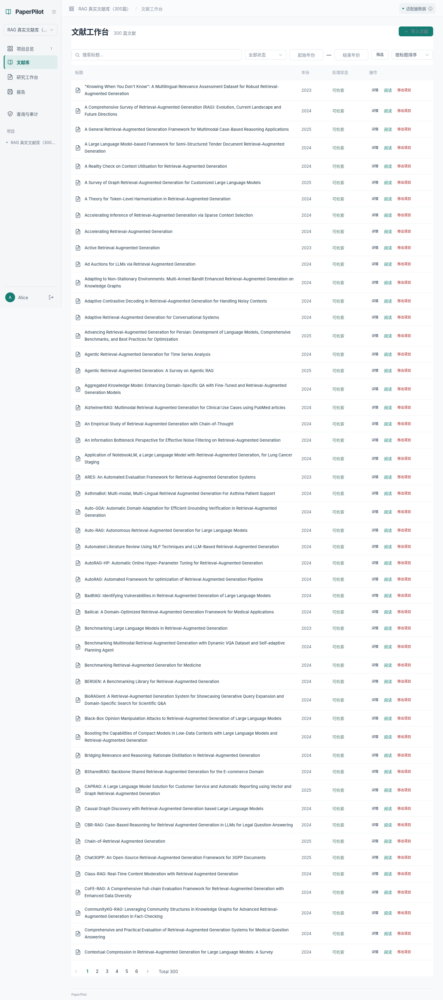

# 300 篇真实 RAG 文献语料

这批语料用于检索规模优化前的数据准备。论文来自 arXiv 的真实全文，按项目现有接口上传，用实际 PDF 解析器和固定版本 BGE 模型分片、嵌入并持久化。最终验收数字见 [`demo/rag-300/summary.json`](../demo/rag-300/summary.json)；它只在全部 PDF、上传副本、分片和索引核验通过后生成。

本机已完成验收：

| 项目 | 实测结果 |
|---|---:|
| 独立论文 / PDF 哈希 | 300 / 300 |
| 页数 / 有文本页数 | 5031 / 5030 |
| 分片 / 512 维向量 | 19659 / 19659 |
| 已提交处理索引 | 300 |
| synthetic 分片 | 0 |
| 原始 PDF | 514,105,919 字节（490.29 MiB） |
| 上传 PDF 副本 | 514,105,919 字节 |
| 独立数据库 | 162,733,079 字节（155.19 MiB） |
| 三者合计 / 剩余空间 | 约 1.11 GiB / 113.23 GiB |

年份分布：2020 年 1 篇、2021 年 2 篇、2022 年 2 篇、2023 年 17 篇、2024 年 252 篇、2025 年 26 篇。复跑导入前后均为 1 个项目、300 篇论文、300 个处理任务及 19659 个向量，见 [`idempotency-check.json`](../demo/rag-300/idempotency-check.json)。数据库保留 300 个成功尝试，以及排查过程中 1 个 `PDF_INVALID` 和 2 个 `AI_INVALID_RESPONSE` 失败尝试。

单进程真实服务的功能检查：关键词、语义、混合三种模式在 2020–2022 年范围内均返回 10 个真实来源；三种模式对完整 300 篇范围均返回 HTTP 503 / `AI_CORPUS_LIMIT`。记录见 [`search-smoke.json`](../demo/rag-300/search-smoke.json)。这不是性能测试。

浏览器检查通过：300 篇列表、每页 50 条、来源详情可打开，无页面脚本错误。常规回归为 **643 passed / 445 skipped**；跳过项包含需要显式隔离数据库配置的契约等测试，不代表这些检查已全部执行。



## 选题和来源

领域为自然语言处理中的检索增强生成（RAG）。官方 API 查询条件为：

```text
cat:cs.CL AND (ti:"retrieval augmented generation" OR ti:"retrieval-augmented generation") AND submittedDate:[202001010000 TO 202512312359]
```

按首次提交时间升序取候选，核对标题确实含有该主题、分类包含 `cs.CL`，排除元数据注明撤稿的条目。以不带版本号的 arXiv ID 和 PDF SHA256 双重去重，接受前 300 篇通过检查的全文。版本在获取时固定；初次提交日期限制不等于修订日期限制。

最初试过截止 2024 年的范围，只得到 275 个合适候选，因此扩至 2025 年。前 39 篇保留自初次下载，后续继续相同来源和验证流程；原始查询缓存保存在本机 `initial-query-2024/`。最终清单中的 `query`、日期、版本和逐文件哈希才是复现依据。

这是一批有明确选择规则的 arXiv 论文，包含预印本；没有逐篇审查同行评议状态，也不代表该领域所有论文或质量排名。不能直接拿它声称检索质量优于某个基准。完整的标题、作者、来源链接、版本、哈希、页数和分片数见 [`catalog.json`](../demo/rag-300/catalog.json)。

下载访问官方 `export.arxiv.org`，串行请求、开始时间至少相隔三秒；遇到限流/服务器错误先退避，连续失败停止，禁止访问时停止。参照 [arXiv API 使用条款](https://info.arxiv.org/help/api/tou.html) 和 [批量访问说明](https://info.arxiv.org/help/bulk_data.html)。PDF 全文留在本机；Git 只保存来源元数据、哈希和验证摘要。

## 空间和数据结构

准备前本机文件系统可用 122,671,112,192 字节（约 114.25 GiB），总容量 421,606,629,376 字节。最终 PDF 字节数、上传副本字节数、数据库大小和剩余空间由验收脚本实测，写入 `summary.json`。数据库大小包含表、TOAST 和索引，不包含整个集群的 WAL；不要把文件系统空闲差值直接当作这批论文的净占用。

本机工作目录为 `/home/huyi/Codes/PaperPilot-corpus300`，开发分支 `feat/member-c-rag-corpus-300` 已同步到 main 的 `ac4d6a0`。数据库为独立的 `paperpilot_corpus300`（schema 8），业务身份 `pp_business_corpus300`。原六篇演示数据库没有被重建或迁移。

| 数据 | 本机位置 / 数据表 |
|---|---|
| 官方原始 PDF | `.runtime/corpus300/papers/` |
| 应用上传后的 PDF 副本 | `.runtime/corpus300/uploads/` |
| 解析分片与页码 | PostgreSQL `chunks` |
| 固定模型版本与向量 | `embedding_models`、`chunk_embeddings` |
| 已原子提交的索引 | `process_indexes`、`project_papers.index_state` |
| 导入状态、任务 ID、项目 ID | `.runtime/corpus300/import-state.json` |
| 本机连接配置和秘密文件 | `.runtime/corpus300/database.json` 及其引用文件；不提交 |

PDF 处理沿用现有实现：pypdf 提取文本层，按页切成最多 1200 字符的片段，相邻重叠 120 字符，不跨页，没有 OCR。嵌入为本地 `BAAI/bge-small-zh-v1.5`、512 维，revision 固定为 `46fbe35fd4374a00fee7de77dfddaeb6dd6a2c59`。这些是英文论文，当前中文 BGE 模型的跨语言质量仍需单独评测。

真实论文 `2402.02764` 暴露了 PDF 字体映射返回 UTF-16 代理字符的问题：旧子进程写 UTF-8 JSON 时抛出 `UnicodeEncodeError`。解析器现在先合并合法代理对，将孤立代理码替换为 `U+FFFD`，再切片；保留页码。修复后使用原 PDF 和原失败任务重试，失败尝试仍保留。没有通过换文件或伪造文本规避问题。

长论文还暴露了 CPU 时间预算问题。`2501.00309` 共 88 页、379 分片，在旧预算下子进程于 60.03 CPU 秒、30.78 墙钟秒退出（SIGKILL），没有输出向量。两线程的 CPU 时间会累加，因此将预算调整为 180 CPU 秒，外层 90 墙钟秒总期限和 3 GiB 地址空间限制仍在。此前 200 分片的 `2407.13193` 在应用中两次返回 `AI_INVALID_RESPONSE`；单独回放曾完整输出 200 个向量、消耗 54.66 CPU 秒，接近旧限制。旧日志未保存退出信号，不能把这两次失败的确切原因视为已证实。现在进程异常退出使用 `AI_EMBEDDING_UNAVAILABLE`；所有失败尝试保留在摘要中。

相同 88 页 PDF 在新预算下完整输出 379 个向量，实测 112.23 CPU 秒、57.52 墙钟秒。此数字仅用于定位入库故障，不是搜索速度或吞吐测试结果。

## 断点续传和验收

在本工作目录执行。以下命令不初始化数据库、不重置密码；连接和模型配置已由本机操作者准备。迁移、建角色的通用入口仍为项目已有 `manage_postgres.py`、`manage_security.py`。

```bash
cd /home/huyi/Codes/PaperPilot-corpus300
export PYTHONPATH="$PWD/backend"

# 官方元数据查询、逐篇下载、解析检查及哈希校验；不会覆盖已有 PDF。
.venv/bin/python scripts/prepare_arxiv_corpus.py

# 已有 PostgreSQL 运行时无需再次启动；先核对状态。
$HOME/.local/opt/postgresql-16.15/bin/pg_ctl \
  -D /home/huyi/Codes/PaperPilot/.runtime/real-demo/postgres status

# 另开终端启动正常单进程演示，避免与正在运行的实例重复。
.venv/bin/python scripts/start_research_demo.py \
  --state-dir "$PWD/.runtime/corpus300" \
  --model-manifest /home/huyi/Codes/PaperPilot/.runtime/ai-model.json \
  --provider-config "$HOME/.openclaw/openclaw.json" \
  --api-port 18802 --web-port 15175

# 已下载的论文正常走认证上传与任务处理接口；跟随增长中的清单。
.venv/bin/python scripts/ingest_research_corpus.py --watch \
  --password-file /home/huyi/Codes/PaperPilot/.runtime/real-demo/secrets/alice-password.txt

# 全部完成后只读核验数据库和两份 PDF，生成摘要与固定子集。
.venv/bin/python scripts/snapshot_research_corpus.py
```

网页地址 `http://127.0.0.1:15175`，账号 `alice`，密码沿用本机六篇演示的密码文件。入库期间临时用 `--api-workers 6`、`--max-pending 8` 加速准备，单进程演示仍是默认。API 多进程模式只用于导入，不作为已验证的 WebSocket 演示配置。停止此应用可创建 `.runtime/corpus300/app.stop`；不删除数据库。

导入器保存稳定项目标记与上传幂等键。请求确认丢失时，重新执行仍使用原键；已完成记录跳过，不新增论文和任务。队列有上限，失败时停止并保留原任务，查清原因后显式重试。下载器不会创建数据库行，导入器不会绕过应用直接塞分片或向量。

验收要求同时满足：300 个独立 arXiv ID、300 个独立 PDF 哈希、两份文件内容一致、300 篇 `searchable`、300 个已提交处理索引、数据库分片数与真实 PDF 检查结果逐篇一致、无 synthetic 分片、向量数量等于分片数量且模型版本/维度一致。摘要中的提交号记录验收时的基础代码；同时保留本分支的 PDF Unicode 修复。

## 后续检索优化与压力测试

本页基线版本有明确的规模限制：`RealAI._corpus()` 枚举项目论文和分片，超过 1000 个候选片段返回 `AI_CORPUS_LIMIT`；关键词、语义和混合检索都会先走这个检查。该基线的 `indexed_vectors()` 逐片读取向量，再在 Python 内计算余弦/BM25/RRF。后续已实现 [PostgreSQL 全库流式 BM25 与精确余弦 Top-K](full-corpus-retrieval.md)，本页保留原始基线及冻结工作集，不覆盖旧测量。新实现仍没有 ANN 索引。

因此，“300 篇成功入库”不等于“300 篇全库搜索已支持”。本次保留该限制作为起点，不调大阈值、截断前若干分片或把错误响应当作高吞吐。只做功能基线探测；不在入库、下载与多进程嵌入同时运行时报告性能数字。

已准备以下固定输入：

- `subsets.json`：按清单顺序固定 10/30/50/100/300 篇的 ID 及分片数量，用于规模曲线。篇数与分片数都要报告。现有公共搜索 API 没有任意论文子集参数；未来测试需用合法项目范围或明确的测试 harness，不能混入其他项目数据。
- `workload.json`：40 条中英文关键词、语义和混合检索输入，Top-K 固定 10。没有人工相关性标注，不可据此编造 Recall@K、nDCG 等效果数字。
- `summary.json`：冻结的清单哈希、数据量、模型版本和存储统计。性能对比前应再次核对。

后续先分别计时鉴权、候选分片读取、向量读取、查询嵌入子进程启动/推理和排序，再决定批量 SQL、SQL Top-K、pgvector HNSW、全文索引或嵌入进程复用的优先级。每个版本保持同一语料、模型、问题、进程数和权限路径，记录冷/热缓存；逐步测并发 1/2/4/8/16，分别报告成功数、错误码、p50/p95/p99、成功 QPS、CPU、RSS、数据库连接数及 SQL 调用量。先建立参考检索结果、抽样标注相关性，再衡量加速带来的召回变化。问答生成受远端模型延迟影响，应与检索吞吐分开测量。
